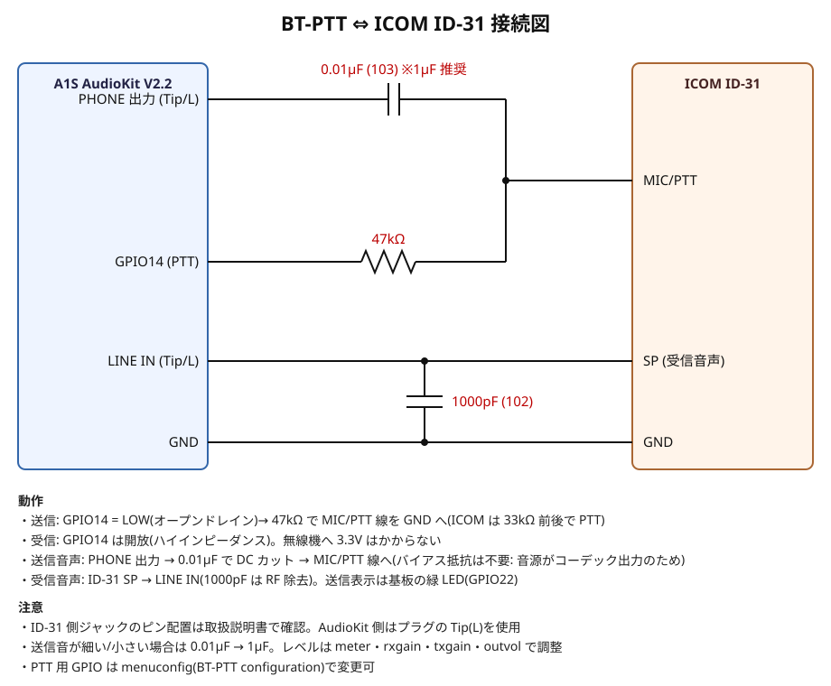

# BT-PTT — Bluetoothヘッドセット ⇔ 無線機 インターフェース

ESP32(**A1S AudioKit V2.2**)を Bluetooth **HFP オーディオゲートウェイ(AG)** として動かし、
市販の Bluetooth ヘッドセットを無線機(**ICOM ID-31**)のマイク/スピーカー/PTT として使うためのファームウェアです。
PTT はヘッドセットの **MFB(マルチファンクションボタン)でトグル**します。

```
BTヘッドセット ──HFP / SCO (CVSD 8kHz)── ESP32 (AG) ──I2S── ES8388
                                                     LINE IN  ← 無線機 SP 出力
                                                     PHONE OUT → 無線機 MIC 入力
                                         IO19 (PTT) → 無線機 PTT 回路
```

## 動作

| 項目 | 内容 |
|---|---|
| 接続 | 起動時、保存済みヘッドセットへ自動接続(切れたら 10 秒ごとに再接続)。未登録なら自動でヘッドセットを検索して接続・保存 |
| 音声 | 接続後に SCO(音声リンク)を常時オープン。受信中は無線機の音をヘッドセットへ |
| PTT | MFB 1回押しで **送信**(高いピッ)、もう1回で **受信**(低いピピッ) |
| TOT | 送信 3 分で「ピピッ」×3 の予告。予告開始から約 6 秒以内に MFB を押すと 3 分延長(ピッ)、押さなければ受信へ戻す(低い長音3回)。`tot` コマンドで時間変更可 |
| 安全 | ヘッドセット切断・SCO 切断時は必ず PTT OFF |
| 本体キー | KEY1(GPIO36):短押し=PTT トグル、3 秒長押し=ヘッドセット検索(ペアリングし直し) |

### MFB の扱い
HFP には「ボタンを押している/離した」という情報がないため、ヘッドセットが MFB で送ってくる
次の AT コマンドを **すべて PTT トグル** として扱います(0.7 秒以内の連続は無視)。

| コマンド | 送られる状況(機種により異なる) |
|---|---|
| `AT+CHUP` | 通話中に押した(`mode call` のとき) |
| `AT+BLDN` | 待機中に押した(`mode idle` のとき、リダイヤル) |
| `AT+BVRA=1/0` | 待機中に長押し(音声認識) |
| `ATA` | 着信中に押した |
| `AT+CKPD` | 古い HSP 型ヘッドセット |

既定は **`mode call`**(ヘッドセットに「通話中」と見せかける)です。ヘッドセットによっては
`mode idle` の方が具合が良い場合があります。シリアルログの `MFB: ...` 行で、実際に何が届いたか確認できます。

## ビルドと書き込み(Windows)

ESP-IDF 5.5.1(`C:\Espressif\frameworks\esp-idf-v5.5.1`)+ ESP-ADF(`C:\Users\user\esp-adf`、
コーデックドライバ `esp_codec_dev` のみ使用)。

```
.\idf_env.bat build
.\idf_env.bat -p COM12 flash monitor
```

* パスは `idf_env.bat` 内で変更できます。
* `esp552\v5.5.2` は Python 環境のパッケージ不足(tree_sitter)で export に失敗したため、5.5.1 を使っています。

## シリアルコンソール(115200 bps)

| コマンド | 内容 |
|---|---|
| `status` | 状態と設定を表示 |
| `scan` | ヘッドセット検索(ヘッドセットをペアリングモードに) |
| `connect <n>` / `connect aa:bb:cc:dd:ee:ff` | 検索結果の番号またはアドレスへ接続(成功すると保存) |
| `forget` | 保存したヘッドセットを消去 |
| `ptt` / `ptt on` / `ptt off` | PTT 操作(試験用) |
| `mode call` / `mode idle` | ヘッドセットへ見せる状態 |
| `tot <秒>` | 送信タイムアウト(0=無効、既定 180) |
| `rxgain <dB>` | 無線機→ヘッドセットの音量(−20〜20) |
| `txgain <dB>` | ヘッドセット→無線機の音量(−20〜20) |
| `outvol <0-100>` | ES8388 出力レベル(無線機マイク入力へ) |
| `meter` | 入力ピークレベルを 5 秒間表示(レベル合わせ用) |
| `reboot` | 再起動 |

設定は NVS に保存されます。

## ハードウェア

### A1S AudioKit V2.2
V2.2 には ES8388 の配線が異なる版が 2 種類あるため、起動時に I2C を調べて自動判定します
(ログの `board:` 行)。AC101 版の A1S は非対応です。

| 用途 | 端子 |
|---|---|
| 無線機 SP 出力 → | **LINE IN** ジャック(左チャンネル/Tip を使用) |
| → 無線機 MIC 入力 | **PHONE(ヘッドホン)** ジャック |
| PTT 出力 | **IO19**(2×7 ヘッダ、オープンドレイン、送信時 LOW)。基板のキーとも共用で、そのキーを押すと直接送信になる。`menuconfig` → *BT-PTT configuration* で変更可 |
| 送信表示 LED | GPIO22 緑 LED(LOW で点灯)。**点灯 = 送信中** |
| 本体 PTT キー | KEY1(GPIO36) |

### ID-31 との接続



プラグの接点ごとの結線: [docs/connectors.svg](docs/connectors.svg)

印刷用: [docs/wiring.pdf](docs/wiring.pdf)(A4、1 ページ目 回路図・2 ページ目 プラグ結線図)

ID-31 は ICOM ハンディ共通の 2 本ピン型(3.5mm = SP、2.5mm = MIC、ピン間隔 10mm)。

| プラグ | Tip | Ring | Sleeve |
|---|---|---|---|
| AudioKit「EARPHONES」(3.5mm ステレオ) | 送信音声(L)→ R1 | 未接続 | GND |
| AudioKit「LINE IN」(3.5mm ステレオ) | 受信音声(L)← C2 | 未接続 | GND |
| ID-31「MIC」(2.5mm) | マイク音声 + PTT(C1 と R3 の合流点) | 未接続 | GND |
| ID-31「SP」(3.5mm) | スピーカー出力 → C2 | 未接続 | GND |

PTT が入らない場合は R3 を 33kΩ → 10kΩ → 3.9kΩ と下げてください。

動作確認済みの ICOM ハンディ機用回路をもとにした推奨構成です。

| 記号 | 値 | 区間 | 内容 |
|---|---|---|---|
| R3 | 33kΩ | IO19 → MIC/PTT | 送信時 IO19 を LOW(オープンドレイン)にして MIC/PTT 線を GND へ引く(ICOM は 33kΩ 前後で PTT 検出。47kΩ でも動作実績あり)。受信時は開放 |
| R1 / R2 | 10kΩ / 100Ω | PHONE 出力 → | 送信音声を約 1/100(−40dB)に減衰。小さければ R2 を 220Ω、大きければ 47Ω |
| C1 | 1µF | → MIC/PTT | DC カット(電解なら + を ID-31 側) |
| C2 | 1µF | SP → LINE IN | DC カット(電解なら + を AudioKit 側) |
| C3 | 1000pF | LINE IN – GND | RF 除去 |

* コンデンサマイク用のバイアス(2.2kΩ → 3.3V)は付けません。音源がコーデック出力なので不要で、付けると PHONE 出力に DC がかかります。
* ID-31 側ジャックのピン配置は取扱説明書で確認してください。
* レベル合わせは `meter`・`rxgain`・`txgain`・`outvol` で行います。ハムが出る場合は音声線に 600:600Ω トランスを入れて絶縁します。

## ライセンス
* `main/`、`docs/` などこのリポジトリのファイル: GPL-2.0-or-later([LICENSE](LICENSE) 参照)。
* ESP-IDF(Apache-2.0)と ESP-ADF(ESPRESSIF MIT License)はこのリポジトリに含まれず、それぞれのライセンスに従います。
* このリポジトリからビルドしたファームウェアを配布する場合は、GPL に従いソースコードも提供してください。
